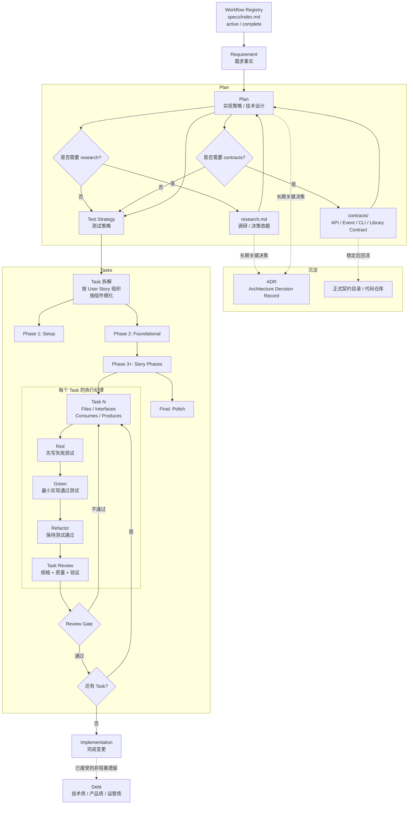

# Standard SDD Artifact Flow



## 核心链路

```text
Workflow -> Requirement -> Plan / Research -> ADR? -> Tasks -> Implementation -> Debt?
```

## Artifact 规则

| Artifact | 策略 | 说明 |
|---|---|---|
| `specs/index.md` | 必需 | workflow registry，管理编号、active/complete、当前阶段和路径 |
| `specs/active/<id-slug>/` | 必需 | 当前进行中的 workflow 目录 |
| `specs/complete/<id-slug>/` | 完成后必需 | 已验收或 review 完成的 workflow 目录 |
| `requirement.md` | 必需 | 长期需求资产，描述系统应该是什么 |
| `plan.md` | 必需 | 实现策略、技术设计、测试策略 |
| `research.md` | 可选 | 只有存在不确定性、选型、外部约束或风险验证时生成 |
| `contracts/` | 可选 | 有外部接口、事件、CLI、library contract 时生成 |
| `ADR` | 可选回流 | `research.md` / `plan.md` 中仍有长期解释价值的关键决策，用 `adr-template.md` 沉淀，并用 `docs/adr/index.md` 管理 |
| `tasks.md` | 必需 | 按 User Story 分 Phase 组织，每个 Task 声明 Files/Interfaces，承载 TDD 微循环和 Review Gate |
| `debt` | 可选回流 | 实现后仍未解决、被明确接受或延后的事项，用 `debt-template.md` 沉淀 |

## 分工原则

`Workflow` 负责编号、active/complete 状态和 `specs/index.md`。

`Requirement` 负责需求事实。

`Plan` 负责设计判断。

`Research` 负责决策证据。

`ADR` 负责长期架构决策记录；`docs/adr/index.md` 负责快速检索和状态管理。

`Contracts` 负责外部契约。

`Tasks` 负责拆解、执行纪律和质量门禁。

`Implement` 负责按任务、TDD、Review Gate 和验证证据完成代码。

`Debt` 负责记录实现后遗留的、已接受的未来事项。
